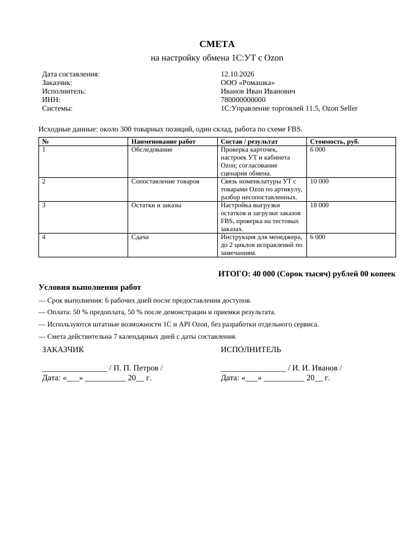
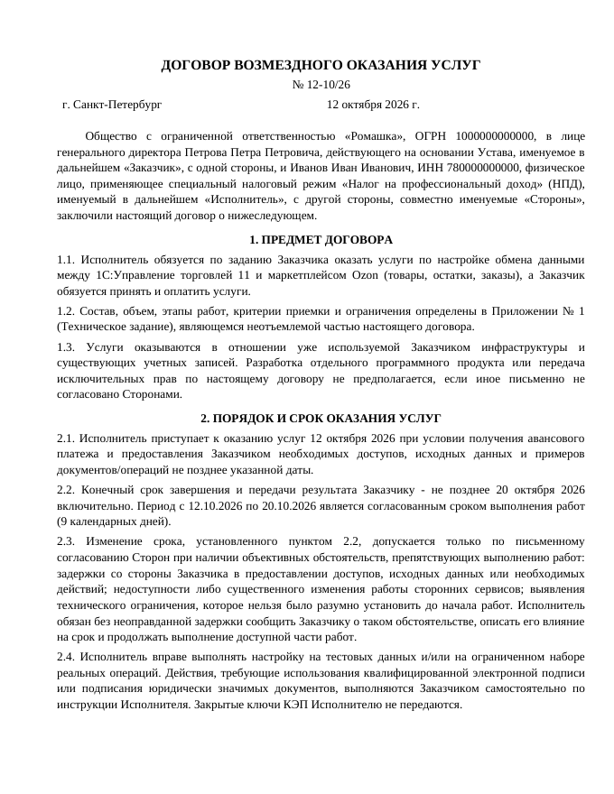

# docgen

делаю комплект документов по заказу из одной строки: смету, договор, ТЗ и акт, сразу в `.docx` и готовые к подписи.

```bash
./make.sh "ООО Ромашка, настройка обмена УТ с Ozon, 40 тысяч, с 12 по 20 октября"
```

пишу заказ одной фразой, Claude Code по ней собирает спецификацию в json по образцу `examples/romashka-ozon.json`: работы и цены, сроки, исходные данные, что сдаю и что не входит. дальше `docgen.py` проверяет спецификацию и собирает четыре документа: Times New Roman 12, пункты по порядку, реквизиты сторон, сумма прописью, подписи. реквизиты, которых я не знаю, остаются «______», дописываю их в json и пересобираю за секунду.

| смета | договор |
|---|---|
|  |  |

в договоре у меня предоплата и остаток после акта, а ещё молчаливая приёмка: если заказчик за 3 рабочих дня не подписал акт и не прислал замечаний, услуги считаются принятыми. без этого второй платёж мог висеть неделями. срок считается от получения доступов, переносы только письменно, работаю на тестовой копии, КЭП и ключи остаются у заказчика. пеню с потолком и факсимиле подписи можно включить флагами в спецификации.

## запуск

```bash
pip install -r requirements.txt
cp executor.example.json executor.json          # свои реквизиты, в git не уходят
python3 docgen.py examples/romashka-ozon.json    # документы в out/12-10-26/
python3 docgen.py examples/romashka-ozon.json --check   # только проверить спецификацию
./make.sh "описание заказа"                      # спецификация через Claude Code и сразу документы
```

## тесты

```bash
python3 -m unittest discover -s tests -t .
```

проверяю сумму прописью (тысячи и миллионы в правильном роде и падеже), итог по работам, даты и обязательные поля.

---
**English.** Generates a ready-to-sign set of Russian service-contract documents (estimate, contract, statement of work, acceptance act) from a JSON spec; the spec can be drafted from a one-line order description by Claude Code. Python + python-docx.

Сергей Гончаров, 1С и автоматизация. [lastochkin1c.ru](https://lastochkin1c.ru) · Telegram [t.me/metaanswer](https://t.me/metaanswer)
